# Engineering Implementation Plan: Roast Tape Coffee Co. UI

Dokumen ini adalah rencana implementasi teknis langkah-demi-langkah (*step-by-step implementation plan*) untuk membangun antarmuka web interaktif **Roast Tape Coffee Co.** berdasarkan PRD yang telah disepakati.

---

## Roadmap Fase Implementasi

```mermaid
flowchart LR
    P1["Fase 1: Setup & Theme Tokens"] --> P2["Fase 2: UI Primitives & Tape System"]
    P2 --> P3["Fase 3: Hero & Draw-Tape Canvas"]
    P3 --> P4["Fase 4: Scroll Narrative & GSAP 3D Tape"]
    P4 --> P5["Fase 5: Peelable Tape Component"]
    P5 --> P6["Fase 6: Product Showcase & Collage Wall"]
    P6 --> P7["Fase 7: Roastery Footer & Polish"]
    P7 --> P8["Fase 8: QA & A11y Audit"]
```



---

## Fase 1: Environment Setup & Design Tokens

### 1.1 Inisialisasi Proyek & Dependencies
* **Framework:** Next.js 15 (App Router, TypeScript).
* **Dependencies Utama:**
  ```bash
  npm install framer-motion gsap @gsap/react lucide-react canvas-confetti
  npm install -D @types/canvas-confetti
  ```

### 1.2 Konfigurasi Font (`next/font`)
Di file `app/layout.tsx`, integrasikan kombinasi tiga font:
* `Fraunces` (Google Font) untuk Display/Heading.
* `Space_Mono` (Google Font) untuk Metadata & Label Tape.
* `Plus_Jakarta_Sans` (Google Font) untuk Body Text & UI.

### 1.3 Konfigurasi Palette Kopi pada Tailwind CSS
Sesuaikan `tailwind.config.ts` untuk memastikan warna bebas dari hitam murni, hijau, dan ungu:

```typescript
// tailwind.config.ts
export default {
  theme: {
    extend: {
      colors: {
        coffee: {
          espresso: '#28160E', // Dark base pengganti hitam
          mocha:    '#5C3826', // Warna primer brand
          cherry:   '#B33927', // Aksen merah ceri kopi
          tape:     '#D97736', // Warna selotip / terracotta
          toffee:   '#E5A85C', // Aksen kuning amber / karamel
          oat:      '#F3E8D8', // Surface kartu & kertas
          foam:     '#FAF5EE', // Background canvas utama
          border:   '#DFD1BF', // Garis tepi kertas kraft
        }
      },
      fontFamily: {
        display: ['var(--font-fraunces)', 'serif'],
        mono:    ['var(--font-space-mono)', 'monospace'],
        sans:    ['var(--font-jakarta)', 'sans-serif'],
      }
    }
  }
}
```

---

## Fase 2: Komponen Primitif (Tape & Paper System)

Membangun komponen dasar yang dapat digunakan berulang di seluruh seksi halaman:

### 2.1 Komponen `TapeStrip` (Selotip Kertas Realistis)
* Komponen SVG atau CSS dengan pinggiran bergerigi (*serrated edges*) dan sedikit transparansi (opacity 92%).
* Menerima properti:
  * `variant`: `'terracotta' | 'kraft' | 'warning'`
  * `text`: Teks berulang di sepanjang pita (misal: `100% ARABICA • FRESH ROAST`).
  * `angle`: Rotasi derajat pita (-5° hingga +5° untuk kesan tempel manual).

### 2.2 Komponen `PaperCard` (Efek Kertas Kraft / Kolase)
* Komponen pembungkus kartu dengan drop-shadow lembut berbasis warna espresso:  
  `box-shadow: 4px 6px 0px 0px rgba(40, 22, 14, 0.15)`.
* Sudut tidak beraturan (asimetris halus: `border-radius: 2px 4px 1px 3px`).

### 2.3 Komponen `CuppingTag` (Stempel Rasa)
* Badge kecil berbentuk stiker stensil untuk menampilkan catatan rasa (*flavor notes*), varietal, dan proses fermentasi.

---

## Fase 3: Hero Section & Draw-Your-Own Tape Canvas

### 3.1 Bouncing Typography Headline
* Implementasikan teks utama menggunakan `framer-motion` dengan varian `type: "spring", damping: 10, stiffness: 100`.
* Karakter huruf bereaksi sedikit terangkat saat kursor mouse lewat (*hover magnetic effect*).

### 3.2 Interactive Tape Canvas
* Gunakan HTML5 `<canvas>` transparan di atas area hero:
  1. Pasang event listener `onMouseDown`, `onMouseMove`, `onMouseUp` (dan versi `onTouch` untuk mobile).
  2. Saat user menyeret kursor, hitung vektor sudut dan panjang garis.
  3. Gambar pita segiempat bertekstur warna `#D97736` dengan teks berulang di dalamnya.
  4. Sediakan tombol melayang *"Reset Tape"* untuk membersihkan canvas jika layar terlalu penuh.

---

## Fase 4: Wavy Marquee Ribbon & GSAP 3D Scroll Narrative

### 4.1 Wavy Marquee Ribbon
* Gunakan jalur SVG melengkung (*curved path*) atau animasi CSS horizontal tanpa henti.
* Latar belakang pita berwarna `coffee-toffee` (`#E5A85C`) dengan teks `coffee-espresso` (`#28160E`).

### 4.2 GSAP ScrollTrigger: 3D Tape Roll Narrative
* Pasang hook `@gsap/react` dengan plugin `ScrollTrigger`:
  * Sebuah elemen gulungan selotip melingkar berputar di sumbu Y dan bergerak turun menyusuri garis tengah halaman seiring pergerakan scroll pengguna.
  * Di belakang gulungan, garis lakban vertikal memanjang mengikuti laju scroll.
* Elemen narasi di kiri dan kanan pita menceritakan 3 tahap:
  1. *The Origin:* Ketinggian kebun, petani mitra, proses petik merah.
  2. *The Roast:* Kurva pemanggangan light-to-medium untuk menonjolkan rasa buah.
  3. *The Seal:* Pengemasan instan dengan nitrogen flush dan lakban segel kedap udara.

---

## Fase 5: Interactive Peelable Tape Component (Gamifikasi Diskon)

### 5.1 Mekanisme Drag & Peel
* Komponen kartu segel amplop:
  * Lapisan bawah: Kode kupon `FIRSTDRIP20` dan tombol salin.
  * Lapisan atas: Selotip lakban bertuliskan `>>> DRAG TO TEAR & UNLOCK 20% OFF <<<`.
* Menggunakan `motion.div` dari Framer Motion:
  * Properti `drag="x"` dengan `dragConstraints={{ left: 0, right: 280 }}`.
  * Transformasi rotasi dan kemiringan (*skew*) saat ditarik untuk mensimulasikan efek selotip yang ditarik lepas dari kertas.
  * Ambang batas (*threshold*): Jika ditarik > 75%, pita otomatis lepas (*peeled state* = true).

### 5.2 Micro-Interactions & Feedback
* Saat pita berhasil lepas:
  * Picu efek ledakan konfeti hangat (warna karamel, toffee, dan ceri) menggunakan `canvas-confetti`.
  * Simpan status di `sessionStorage` agar voucher tetap terbuka jika halaman di-refresh.

---

## Fase 6: Product Showcase & Scrapbook Wall

### 6.1 Beans Showcase Grid
* Buat 3 kartu produk unggulan:
  1. *Ethiopia Yirgacheffe (Floral & Peach)*
  2. *Colombia Huila Pink Bourbon (Caramel & Citrus)*
  3. *Sumatra Kerinci Anaerobic (Tropical Fruit & Spice)*
* Tiap kartu dilengkapi dengan foto kantong kopi, stiker *roast date*, dan tombol *"Bag It"* interaktif.

### 6.2 Scrapbook Barista Journal & UGC
* Tata letak *CSS Grid* asimetris dengan rotasi acak (-3° hingga +4°) pada kartu polaroid.
* Tiap foto polaroid diberi komponen `TapeStrip` di sudut atas seolah-olah direkatkan langsung di dinding kafe.

---

## Fase 7: Duct-Taped Roastery Footer & Finishing

### 7.1 Cardboard Box Footer
* Gunakan latar warna karton kraft tebal (`#EBDBC8`).
* Hiasi bagian atas footer dengan selotip lakban silang diagonal bertuliskan:  
  `FRAGILE • AROMA SEALED • ROAST TAPE CO.`.
* Form newsletter dibuat menyerupai label pengiriman barang (*shipping manifest label*).

---

## Fase 8: QA, Accessibility & Checklist Validasi

| Parameter | Kriteria Sukses | Cara Pengujian |
| :--- | :--- | :--- |
| **Pemeriksaan Palet Warna** | 0% warna hitam (`#000`), hijau, atau ungu di CSS | Search codebase regex: `(#000000\|green\|purple\|#000\|rgb\(0,0,0\))` |
| **Rasio Kontras (a11y)** | Kontras teks espresso di atas kanvas latte ≥ 12:1 | Chrome DevTools Lighthouse Accessibility Audit |
| **Mobile Responsiveness** | Gesture drag/swipe berfungsi mulus pada layar sentuh | Uji coba di iOS Safari & Android Chrome viewport (375px - 768px) |
| **Performa Animasi** | Scroll tetap stabil di 60 FPS tanpa jank | Profiling frame rate di Chrome DevTools Performance panel |
