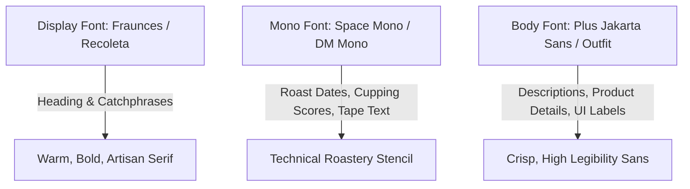
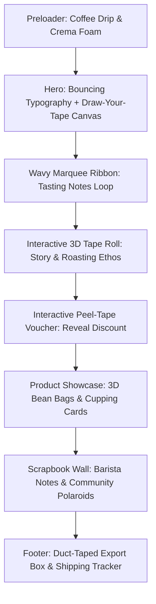

# Product Requirements Document (PRD): UI & Experience Architecture
## Project: Roast Tape Coffee Co. — Interactive Specialty Roastery Landing Page

---

## 1. Executive Summary & Vision

### 1.1 Objective
Membangun antarmuka landing page interaktif untuk **Roast Tape Coffee Co.** (brand *specialty coffee roastery* independen) dengan mengadaptasi arsitektur komponen **Huggo Tape Template** (21st.dev / Playful Brand Scroll). 

Tujuan utama UI ini adalah menggabungkan **kultur taktil kopi kriya** (*roastery craft, cupping notes, kraft packaging, sealed boxes*) dengan pengalaman web interaktif modern yang mendorong eksplorasi produk, waktu retensi kunjungan, dan konversi belanja biji kopi.

### 1.2 Target Pengguna
* **Urban Coffee Explorers & Home Brewers (Usia 20–35):** Penggemar *manual brew* (V60, Aeropress, Espresso) yang mengapresiasi estetika kemasan, transparansi *origin*, dan pengalaman visual unik.
* **Gen-Z / Millennial Lifestyle Consumers:** Konsumen yang tertarik pada brand berciri khas visual kuat, tidak kaku, dan layak dibagikan (*shareable*) ke media sosial.

### 1.3 Key Experience Metaphors
* **Lakban Kertas (Kraft Tape):** Representasi segel kotak pengiriman biji kopi dan label tanggal sangrai (*roasting date*).
* **Kolase Kertas (Paper Collage):** Representasi kertas saring (*coffee filter*), kartu *cupping notes*, dan foto polaroid perkebunan kopi.
* **Segel Robek (Peel/Tear Effect):** Metafora merobek ritsleting segel kantong kopi kedap udara untuk mendapatkan promo atau kejutan rasa.

---

## 2. Design System & Style Guidelines

> [!IMPORTANT]
> **Batasan Warna Ketat:** Desain ini **TIDAK MENGGUNAKAN** warna hitam murni (`#000000`), hijau, maupun ungu dalam seluruh elemen visual, teks, border, maupun shadow.

### 2.1 Color Palette Tokens

```
Canvas & Base:
├── --bg-canvas:       #FAF5EE (Warm Latte Foam / Vanilla Milk)
├── --surface-card:    #F3E8D8 (Oat Milk Beige / Raw Paper)
└── --text-primary:    #28160E (Dark Espresso Roast - Non-Black Dark Base)

Brand & Accents:
├── --brand-primary:   #5C3826 (Warm Mocha / Roasted Coffee Bean)
├── --accent-tape:     #D97736 (Burnt Terracotta / Caramel Kraft Tape)
├── --accent-cherry:   #B33927 (Ripe Coffee Cherry Red - Highlight & Badges)
├── --accent-toffee:   #E5A85C (Creamy Amber Toffee - Marquee & Ribbons)
└── --border-kraft:    #DFD1BF (Soft Paperboard Border)
```

| Token Name | Nilai HEX | Peruntukan UI |
| :--- | :--- | :--- |
| `Dark Espresso Roast` | `#28160E` | Teks utama, logo, ikon kontras tinggi, pengganti warna hitam. |
| `Warm Mocha` | `#5C3826` | Tombol primer, sub-heading, garis bingkai tegas. |
| `Burnt Terracotta` | `#D97736` | Objek pita tape 3D, selotip interaktif, status kursor aktif. |
| `Coffee Cherry Red` | `#B33927` | Badge *"Limited Batch"*, label diskon, CTA sekunder, dot indikator. |
| `Creamy Amber Toffee`| `#E5A85C` | Pita *marquee ribbon* berjalan, aksen bintang rating, stiker promo. |
| `Oat Milk Beige` | `#F3E8D8` | Latar belakang kartu produk, kartu resep seduh, modal pop-up. |
| `Warm Latte Foam` | `#FAF5EE` | Latar belakang kanvas halaman utama (hangat & ramah mata). |

---

### 2.2 Typography Hierarchy



1. **Display / Hero Titles:**
   * **Font Family:** `Fraunces` (Variable Serif) atau `Recoleta`.
   * **Weight:** 700 / 900 (Soft Bold with warm curves).
   * **Warna:** `#28160E` (Espresso).
2. **Metadata, Badges & Tape Labels:**
   * **Font Family:** `Space Mono` (Monospace).
   * **Weight:** 500 / 700 (Uppercase, Letter-spacing: +0.08em).
   * **Karakter:** Menciptakan impresi stempel manual karung goni dan label laboratorium *cupping*.
3. **Body Text & UI Navigation:**
   * **Font Family:** `Plus Jakarta Sans` atau `Outfit`.
   * **Weight:** 400 (Regular), 600 (Semi-Bold).
   * **Line Height:** 1.6 untuk kenyamanan membaca deskripsi beans.

---

## 3. UI Component Architecture & Page Flow



---

### 3.1 Section 0: Interactive Preloader
* **Deskripsi:** Transisi pembuka saat aset 3D dan font dimuat.
* **Elemen UI:**
  * Ikon animasi tetesan kopi (*coffee drip*) mengisi cangkir siluet.
  * Bar persentase loading dengan tipografi monospace (`Space Mono`).
  * Teks dinamis: *"Calibrating Grind Size...", "Heating Water to 93°C...", "Ready to Pour."*
* **Transisi Selesai:** Tirai layar terbuka ke atas seperti kertas yang ditarik cepat.

---

### 3.2 Section 1: Hero Section (Draw-Your-Tape Canvas)
* **Tujuan:** *Instant engagement* dalam 3 detik pertama dengan interaksi kursor langsung.
* **Elemen UI:**
  1. **Navbar Mengambang (Floating Paper Bar):** 
     * Latar `#F3E8D8` dengan bayangan lembut berwarna `#5C3826`/15%.
     * Menu: *The Roasts, Brew Guides, Origin Story, Cart (0)*.
  2. **Bouncing Headline:**
     * *"NOT YOUR ORDINARY CAFFEINE FIX."* (Font Fraunces ukuran 4.5rem–7rem, animasi *spring bounce* saat kursor bergerak mendekat).
  3. **Interactive Hero Canvas (Draw-Your-Own Tape):**
     * Pengunjung dapat mengklik dan menyeret (*drag*) kursor melintasi layar untuk menempelkan pita selotip virtual kustom bertuliskan:  
       `★ FRESH ROAST ★ 100% ARABICA ★ DIRECT TRADE ★`.
     * Tombol *"Clear Tape"* kecil di pojok kanan bawah canvas.
  4. **Call-to-Action (CTA):**
     * Tombol Primer: *"Claim Today's Roast"* (Background `#5C3826`, teks `#FAF5EE`, efek stiker timbul).
     * Tombol Sekunder: *"Explore Tasting Notes"* (Outline tape `#D97736`).

---

### 3.3 Section 2: Wavy Marquee Ribbon
* **Deskripsi:** Pita dekoratif yang bergelombang (*sine wave motion*) bergerak secara *infinite horizontal scroll*.
* **Visual:**
  * Warna pita: `Creamy Toffee` (`#E5A85C`) dengan teks `Dark Espresso` (`#28160E`).
  * Isi Teks: `ETHIOPIA YIRGACHEFFE • ANAEROBIC NATURAL • NOTES OF PEACH & BROWN SUGAR • COLOMBIA HUILA • WASHED PROCESS • NOTES OF CITRUS & CARAMEL •`.

---

### 3.4 Section 3: The 3D Tape Roll Narrative (Scroll-Triggered Story)
* **Mekanisme Interaksi:**
  * Terhubung dengan **GSAP ScrollTrigger**.
  * Saat user melakukan scroll ke bawah, sebuah gulungan selotip 3D (*Kraft Tape Roll*) berputar dan menggelinding ke bawah secara vertikal, merekatkan pita lakban cokelat (`#D97736`) di tengah halaman.
* **Konten Lapisan Kiri & Kanan (Paper Collage):**
  * **Sisi Kiri:** Potongan kertas sobek menampilkan elevasi kebun (*1,800 MASL*), foto petani mitra dengan *washi tape* di sudut-sudutnya.
  * **Sisi Kanan:** Sketsa grafik profil pemanggangan (*Roast Profile Curve*) dengan stempel stensil merah ceri: *"LIGHT-MEDIUM ROAST FOR CLARITY"*.

---

### 3.5 Section 4: Interactive Peelable Tape Voucher
* **Tujuan Konversi:** Mengubah pengunjung menjadi pembeli pertama melalui *gamification*.
* **Visual & Perilaku:**
  * Kotak amplop kertas bertuliskan: *"ROASTERY SECRET SEAL: PEEL TO UNLOCK"*.
  * Terdapat lakban horizontal tebal bertuliskan: `>>> DRAG OR SWIPE TO TEAR <<<`.
  * **Interaksi:** User melakukan drag dari kiri ke kanan. Terdengar efek suara kertas robek halus (opsional dengan tombol mute) dan pita terkelupas dengan efek 3D *mesh distortion*.
  * **Hasil:** Muncul kode voucher: `FIRSTDRIP20` (Diskon 20% pembelian pertama) dan tombol *"Apply to Cart"*.

---

### 3.6 Section 5: The Beans Shop (3D & Collage Product Cards)
* **Grid Layout:** 3 Kolom kartu bergaya kemasan kopi fisik yang ditempel di latar belakang.
* **Elemen Tiap Kartu Produk:**
  * **Bag Header:** Stiker penutup kemasan dengan warna kontras (misal: `#B33927` untuk edisi langka).
  * **Render Produk:** Kantong kopi matte dengan tekstur kertas asli.
  * **Cupping Flavor Tags:** Tag berbentuk stiker kecil bertuliskan: `[Jasmine]`, `[Bergamot]`, `[Wild Honey]`.
  * **Spesifikasi Teknis (Space Mono):**
    * *Varietal:* Geisha / Typica.
    * *Process:* Honey Process.
    * *Altitude:* 1,950m.
  * **Tombol Interaktif:** Tombol *"Bag It — Rp 145.000"* dengan animasi stempel saat diklik.

---

### 3.7 Section 6: Scrapbook Wall (Barista Journal & UGC)
* **Desain:** Tampilan papan kliping (*moodboard*) fisik berisi ulasan komunitas dan resep seduh.
* **Komponen:**
  * Foto polaroid customer menyeduh di rumah, ditempel dengan lakban transparan karamel.
  * Catatan resep barista ditulis tangan: *"Ratio 1:16 • 15g Beans • 240g Water at 92°C • 2m 45s Total Drip"*.
  * Tombol CTA: *"Tag @RoastTape on Instagram to get pinned on the board"*.

---

### 3.8 Section 7: Duct-Taped Roastery Footer
* **Visual:**
  * Menggunakan tekstur kardus bergaris (*kraft cardboard* `#EBDBC8`) yang "ditempel" secara kasar di bagian bawah menggunakan selotip duct-tape besar berwarna `#D97736`.
  * Pita lakban bertuliskan: `⚠️ HANDLE WITH CAFFEINE • SHIPPED WITHIN 48 HOURS OF ROASTING ⚠️`.
* **Isi Footer:**
  * Formulir Newsletter: *"Join the Roast Dispatch"* (Input field dengan border seperti kotak alamat paket pos).
  * Navigasi: FAQ, Kebijakan Roasting, Kontak Barista, Wholesale / B2B Supply.
  * Hak Cipta: *"© 2026 Roast Tape Coffee Co. Crafted with care, no bitter aftertaste."*

---

## 4. Technical Specifications & Animation Logic

### 4.1 Tech Stack
* **Framework:** Next.js 15 (React 19, App Router) + TypeScript.
* **Styling:** Tailwind CSS (dengan custom theme tokens untuk palet kopi).
* **Motion & Animasi:** 
  * `framer-motion` untuk gesture drag pada peelable tape dan interaksi bouncing text.
  * `gsap` + `ScrollTrigger` untuk simulasi perputaran 3D tape roll yang sinkron dengan posisi scroll.
* **Icons:** `lucide-react` (disesuaikan warna stroke menjadi `#28160E` dan `#5C3826`).

### 4.2 Responsiveness & Mobile Adaptations
* **Desktop (> 1024px):** Interaksi canvas kursor "Draw-your-tape" aktif penuh, 3D tape roll di tengah grid 3 kolom.
* **Mobile / Tablet (< 768px):** 
  * Interaksi "Draw-your-tape" beralih menjadi ketukan (*tap-to-place sticker*).
  * Gesture "Peelable Tape" mendukung *touch-swipe* horizontal dengan haptic feedback (jika didukung browser mobile).
  * Product grid beralih menjadi *horizontal swipeable snap-carousel* bergaya kartu tumpuk (*stacked cards*).

### 4.3 Accessibility (a11y) & Performance
* **Kontras Teks:** Semua teks utama `#28160E` di atas latar `#FAF5EE` memiliki rasio kontras > 12:1 (jauh melampaui standar WCAG AAA).
* **Reduced Motion:** Mendukung `@media (prefers-reduced-motion: reduce)` dengan mematikan animasi rotasi pita 3D dan menggantinya dengan pita statis bersih.

---

## 5. Metrics & Acceptance Criteria

| Indikator Keberhasilan | Target | Cara Pengukuran |
| :--- | :--- | :--- |
| **Hero Engagement** | ≥ 35% pengunjung mencoba menggambar tape / tap interaksi | Event tracking kursor canvas di analytics |
| **Voucher Peel Rate** | ≥ 40% dari pengunjung yang mencapai Section 4 mengupas lakban | Click/Drag event pada peel component |
| **Scroll Depth** | ≥ 60% pengunjung mencapai Product Showcase (Section 5) | Scroll-depth analytics milestone |
| **Lighthouse Score** | Performance ≥ 85, Accessibility ≥ 95 | Google PageSpeed audit |
